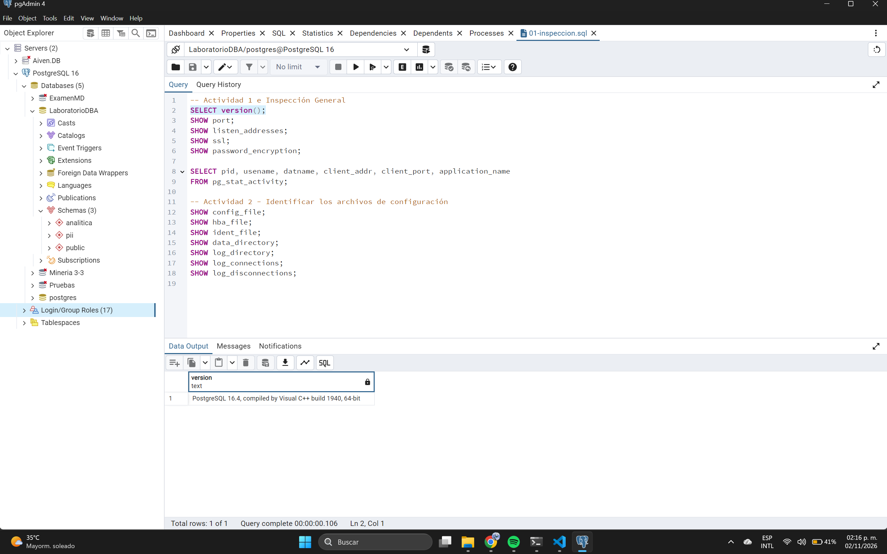
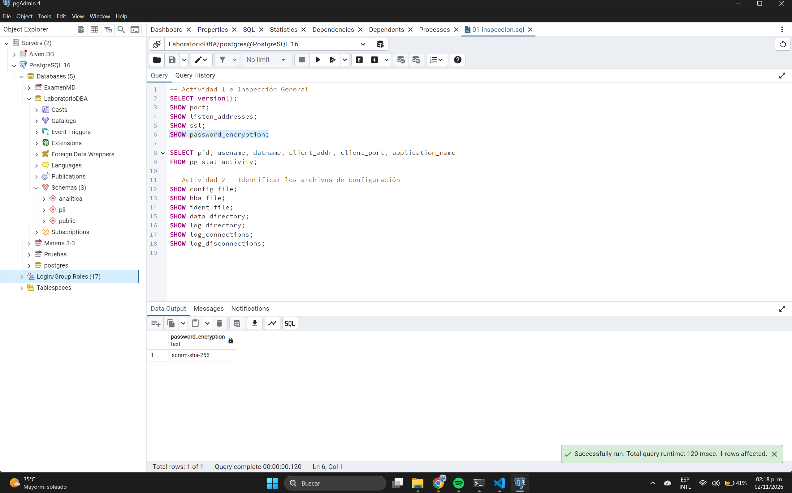
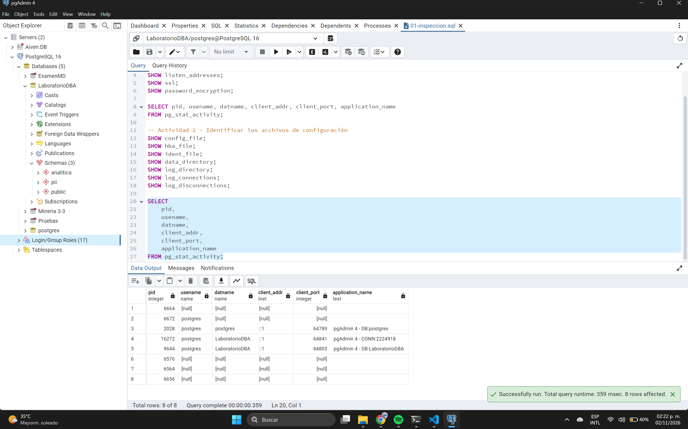
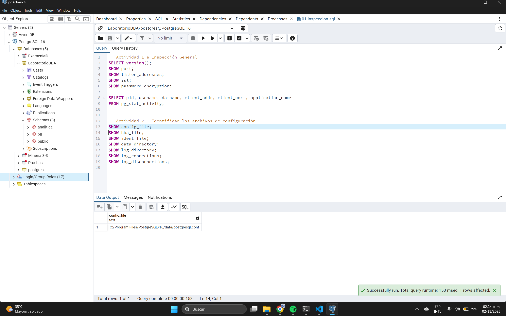
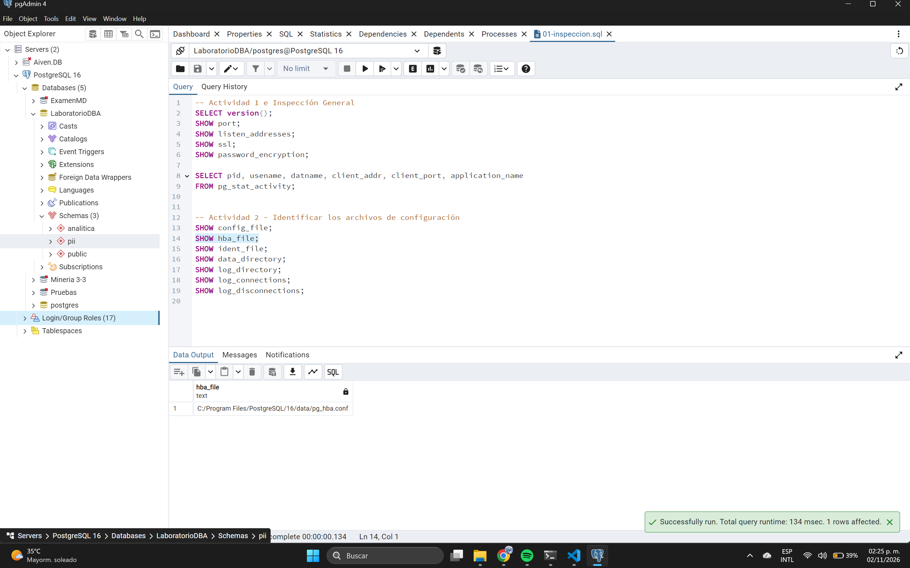
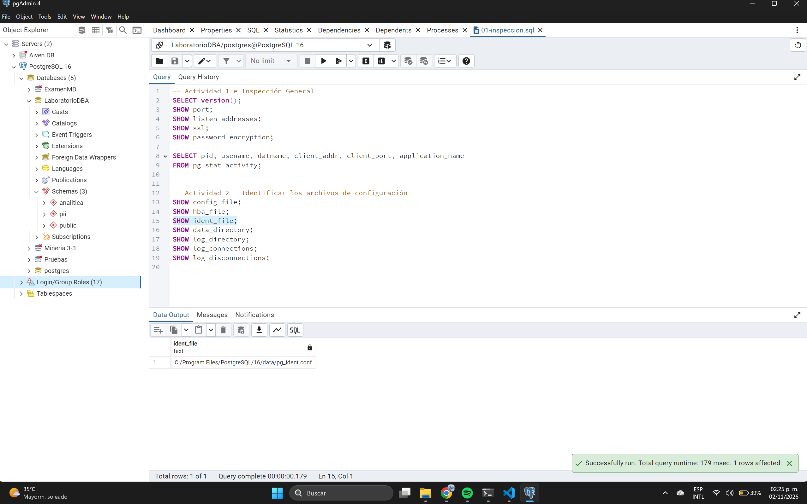
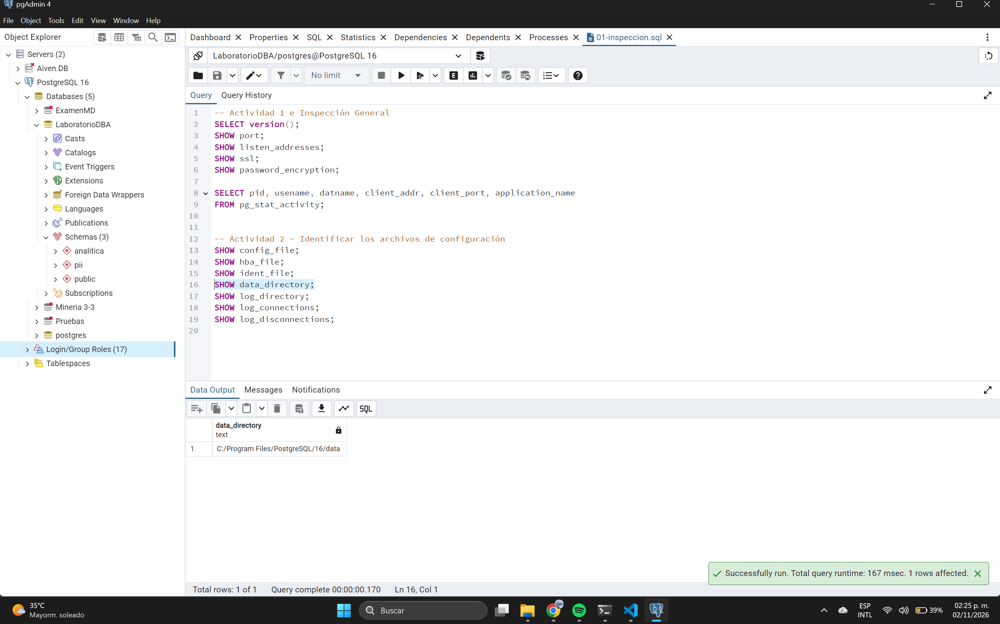
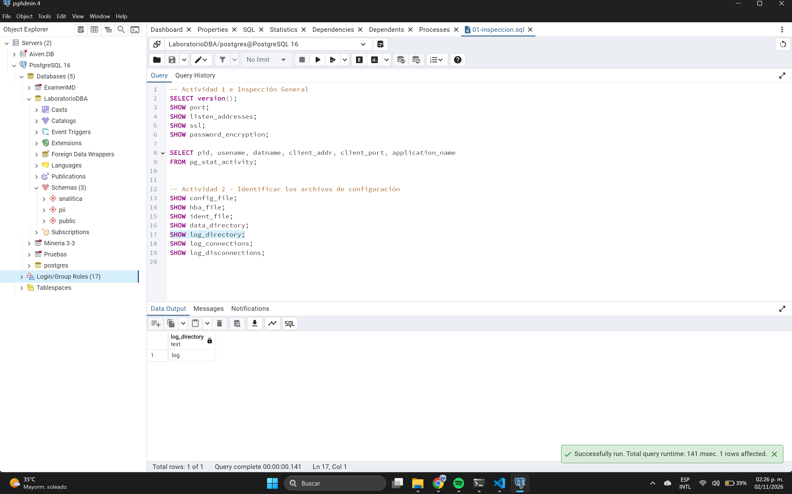
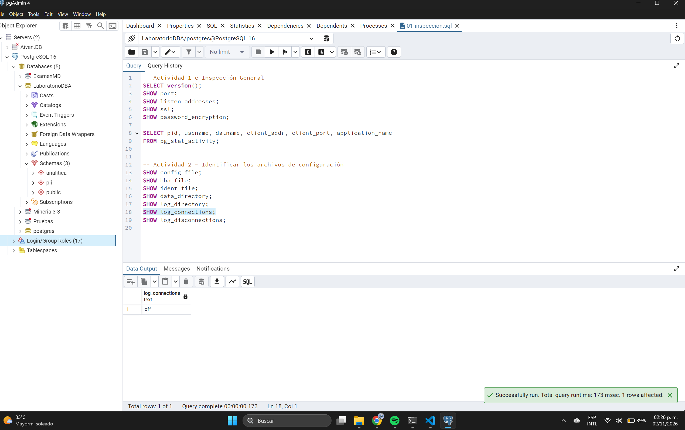
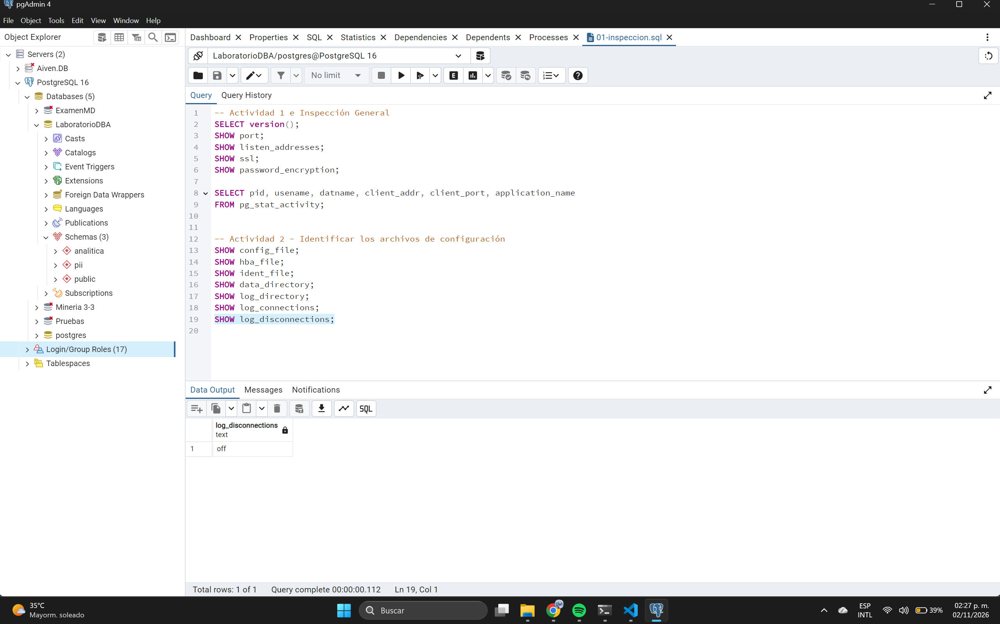

## Actividad 1 - Identificar la superficie de ataque

**Registro de estado inicial:**
| Elemento | Estado actual | ¿Es necesario? | Riesgo |
| :--- | :--- | :--- | :--- |
| Puerto PostgreSQL | `5432` | Sí | Moderado (si está expuesto a Internet) |
| Interfaces de escucha | `*` (Todas) | No | Alto (permite conexiones externas no deseadas) |
| Conexiones remotas | Habilitadas sin filtro | Solo a la IP de la App | Alto (Fuerza bruta) |
| Usuarios administrativos | Creados y usados por la App | Solo para DBAs | Crítico (Compromiso total) |
| SSL/TLS | `off` | No (Debe ser `on`) | Alto (Sniffing de credenciales) |
| Métodos de autenticación | `md5` / `trust` | No (Debe ser `scram-sha-256`) | Moderado-Alto |

**¿Por qué conocer la superficie de ataque debe preceder al hardening?**
Porque no se puede proteger lo que no se conoce. Identificar los componentes expuestos permite dirigir los esfuerzos de seguridad donde realmente se necesitan (como cerrar puertos o cambiar métodos de autenticación) y evitar afectar servicios que sí son necesarios.

## Actividad 2 - Identificar los archivos de configuración

**¿Por qué es importante conocer la ubicación física de estos archivos?**
Porque la seguridad de la base de datos depende del sistema operativo. Conocer la ubicación permite auditar y asegurar los permisos a nivel de archivos (CHMOD/CHOWN) para evitar que atacantes locales lean credenciales o manipulen la configuración directamente.