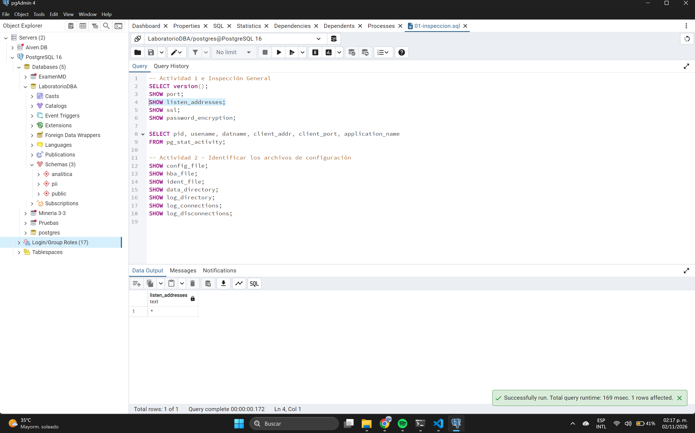

# Actividad 3 - Revisar listen_addresses

**Análisis de arquitectura:**
La arquitectura de **Internet -> Firewall -> Red Privada -> Servidor PostgreSQL** reduce mejor la exposición. Al estar en una red privada detrás de un firewall, el tráfico de internet nunca llega directamente al puerto 5432. Esto aisla el motor de base de datos de escaneos masivos y ataques directos desde el exterior.