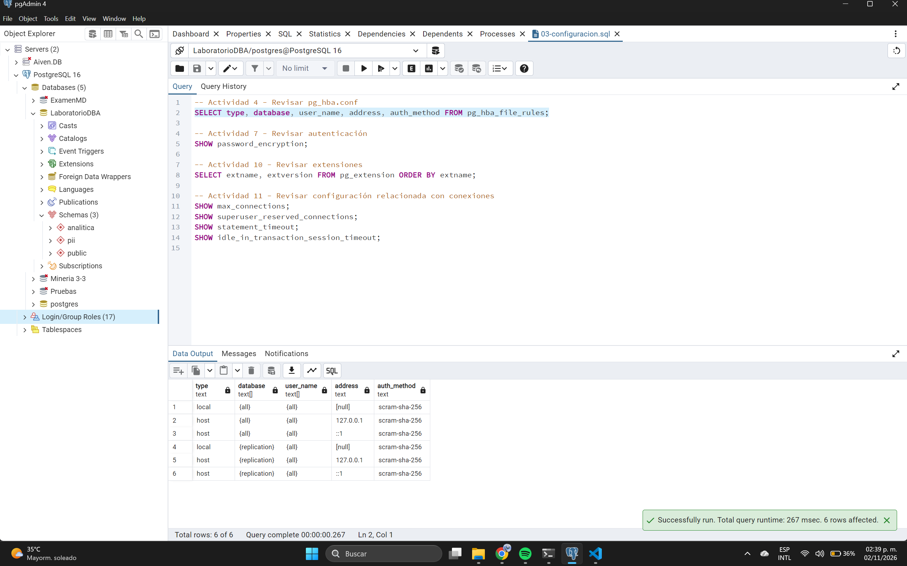

# Actividad 4 - Revisar pg_hba.conf

## 1. Consulta SQL ejecutada
Para revisar las reglas configuradas en el archivo de autenticación basada en host de PostgreSQL, se ejecutó la siguiente consulta:

```sql
SELECT type, database, user_name, address, auth_method 
FROM pg_hba_file_rules;
```

