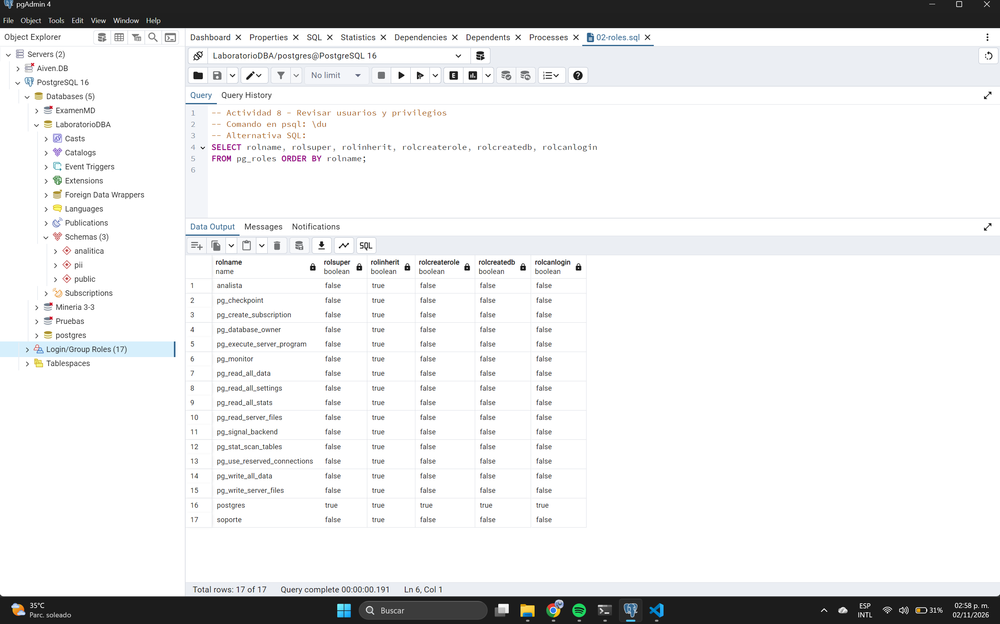
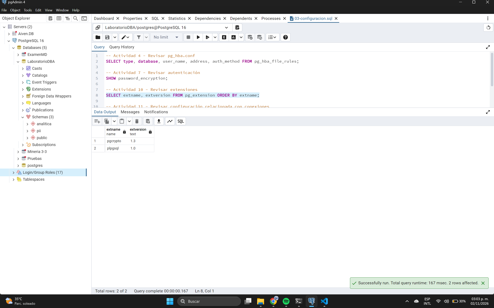
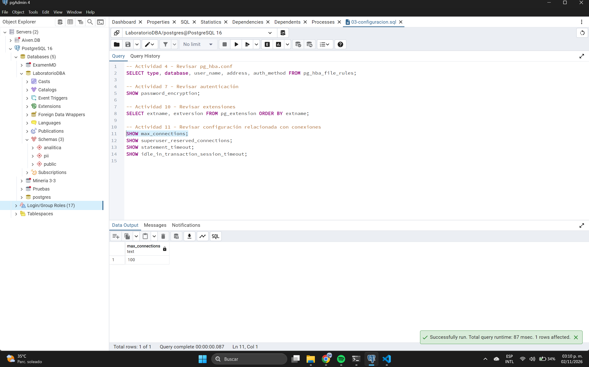
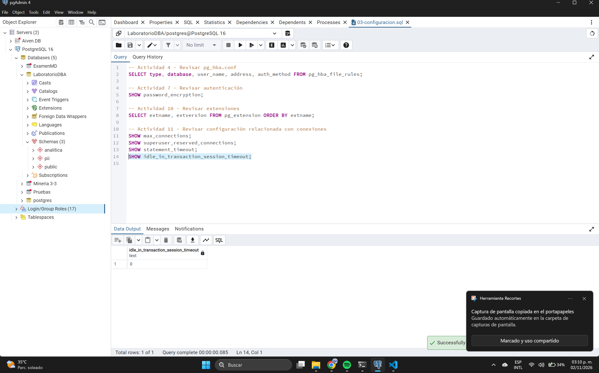

# Actividad 5 - Analizar una regla permisiva
**Regla actual:** `host all all 0.0.0.0/0 scram-sha-256`
1. **¿Qué bases de datos permite?** Todas (`all`).
2. **¿Qué usuarios permite?** Todos (`all`).
3. **¿Qué direcciones de origen permite?** Cualquier IP IPv4 del mundo (`0.0.0.0/0`).
4. **¿Qué método de autenticación utiliza?** `scram-sha-256`.
5. **¿Por qué puede representar una exposición innecesaria?** Porque abre la puerta a que cualquier persona en Internet intente conectarse, facilitando ataques de fuerza bruta o denegación de servicio, aunque la autenticación sea fuerte.
6. **¿Qué información necesitarías para restringirla?** La IP o subred exacta desde donde se conectará la aplicación y el administrador, y el nombre de la base de datos y usuario específicos.

# Actividad 6 - Aplicar mínimo privilegio a conexiones
**Regla propuesta (Ejemplo):**
`host basedatos_app app_user 10.10.10.20/32 scram-sha-256`

# Actividad 7 - Revisar autenticación
**Preguntas:**
1. **¿Qué diferencia existe entre autenticación y autorización?** Autenticación verifica *quién* eres (usuario/contraseña). Autorización define *qué* puedes hacer una vez autenticado (permisos DML/DDL).
2. **¿Qué protege scram-sha-256?** Protege las contraseñas contra ataques de interceptación y de fuerza bruta, utilizando un hash fuerte con sal criptográfica.
3. **¿Por qué una contraseña almacenada mediante un mecanismo de autenticación no debe confundirse con cifrado reversible?** Porque los hashes (`scram`) son funciones unidireccionales; no es posible "descifrar" la contraseña original a partir del hash.
4. **¿Qué sucede si una cuenta tiene permisos excesivos aunque utilice una contraseña fuerte?** Si el usuario o la aplicación sufre una brecha (ej. inyección SQL), el atacante tendrá control total sobre la base de datos, burlando la fortaleza de la contraseña inicial.

# Actividad 8 - Revisar usuarios y privilegios



| Rol | LOGIN | SUPERUSER | CREATEROLE | CREATEDB | Función |
| :--- | :---: | :---: | :---: | :---: | :--- |
| `analista` | **No** (`false`) | **No** (`false`) | **No** (`false`) | **No** (`false`) | Rol personalizado de grupo/consulta con herencia (`rolinherit = true`), diseñado para otorgar acceso acumulativo a analistas de datos sin capacidad de inicio de sesión directo.|
| `postgres` | **Sí** (`true`) | **Sí** (`true`) | **Sí** (`true`) | **Sí** (`true`) | Cuenta superadministradora predeterminada del servidor. Tiene control total sobre el motor DBMS, la creación de roles, bases de datos y bypass de RLS.|
| `soporte` | **No** (`false`) | **No** (`false`) | **No** (`false`) | **No** (`false`) | Rol de grupo destinado al personal de soporte técnico para delegación de permisos específicos sobre esquemas o tablas sin credenciales de inicio directo.|
| `pg_read_all_data` | **No** (`false`) | **No** (`false`) | **No** (`false`) | **No** (`false`) | Rol predefinido del sistema que otorga privilegios de lectura (`SELECT`) sobre todas las tablas, vistas y secuencias de la instancia.|
| `pg_write_all_data` | **No** (`false`) | **No** (`false`) | **No** (`false`) | **No** (`false`) | Rol predefinido del sistema que otorga privilegios de escritura (`INSERT`, `UPDATE`, `DELETE`) en todas las tablas, vistas y secuencias.|
| `pg_database_owner` | **No** (`false`) | **No** (`false`) | **No** (`false`) | **No** (`false`) | Rol implícito que posee de forma automática el propietario de la base de datos actual para la gestión de sus objetos.|
| `pg_execute_server_program` | **No** (`false`) | **No** (`false`) | **No** (`false`) | **No** (`false`) | Rol administrativo crítico del sistema que permite a un usuario ejecutar programas del sistema operativo en el servidor desde la base de datos.|
| `pg_read_server_files` | **No** (`false`) | **No** (`false`) | **No** (`false`) | **No** (`false`) | Rol predefinido que permite leer archivos locales del sistema operativo desde la interfaz del servidor PostgreSQL (mediante `COPY` o funciones de archivos).|
| `pg_write_server_files` | **No** (`false`) | **No** (`false`) | **No** (`false`) | **No** (`false`) | Rol predefinido que permite escribir o modificar archivos en el sistema operativo del servidor donde corre la instancia de PostgreSQL.|
| Roles del sistema (`pg_checkpoint`, `pg_create_subscription`, `pg_monitor`, etc.) | **No** (`false`) | **No** (`false`) | **No** (`false`) | **No** (`false`) | Roles predefinidos de PostgreSQL (15 filas en total) destinados a la delegación granular de tareas de monitoreo, mantenimiento, replicación y métricas.|

**¿Por qué no debería utilizarse una cuenta SUPERUSER como cuenta normal de una aplicación?**
Porque si la aplicación es vulnerada, el atacante heredará los privilegios del superusuario, pudiendo alterar configuraciones globales, acceder a bases de datos de otras aplicaciones, o ejecutar código a nivel del sistema operativo.

# Actividad 9 - Separar cuentas administrativas y de aplicación
**¿Qué riesgo existe si la aplicación se conecta utilizando una cuenta administrativa?**
El riesgo es el compromiso total del sistema. Cualquier vulnerabilidad en el código de la aplicación comprometerá la integridad, confidencialidad y disponibilidad de toda la instancia, y no solo de los datos pertinentes a esa aplicación.

# Actividad 10 - 



# Actividad 10 - Revisar extensiones

**Consulta ejecutada:**
```sql
SELECT extname, extversion FROM pg_extension ORDER BY extname;
```

**Resultados obtenidos (basados en la captura de pantalla):**
| extname  | extversion |
| :---     | :---       |
| pgcrypto | 1.3        |
| plpgsql  | 1.0        |

---

### Determinaciones:

**1. ¿Qué extensiones existen?**
En la base de datos actual existen instaladas dos extensiones: `pgcrypto` (versión 1.3) y `plpgsql` (versión 1.0).

**2. ¿Cuáles son necesarias?**
La extensión `plpgsql` (PostgreSQL Procedural Language) suele ser estrictamente necesaria, ya que es el lenguaje procedimental por defecto de PostgreSQL. Es requerido si la base de datos o el esquema actual utiliza funciones personalizadas, procedimientos almacenados o triggers (disparadores).

**3. ¿Cuáles fueron instaladas para prácticas?**
La extensión `pgcrypto` fue muy probablemente instalada de manera explícita para prácticas (seguramente para ejercicios de cifrado, hasheo de contraseñas u ocultamiento de datos vistos en laboratorios anteriores como el LAB-01 o LAB-02 mencionados en la guía). 

**4. ¿Cuáles podrían representar funcionalidad innecesaria en otro entorno?**
`pgcrypto` podría representar una funcionalidad innecesaria en un entorno de producción donde la base de datos no tenga la responsabilidad directa de realizar operaciones criptográficas (por ejemplo, si el cifrado y descifrado de datos se maneja exclusivamente a nivel de la capa de aplicación). 

# Actividad 11 - Revisar configuración relacionada con conexiones





**¿Por qué mantener conexiones indefinidamente abiertas puede representar un problema?**
Consumen recursos vitales del servidor (memoria, descriptores de archivos, bloqueos/locks). Si se satura el límite de `max_connections`, se genera una Denegación de Servicio (DoS), impidiendo nuevas conexiones legítimas.

# Actividad 12 - Revisar permisos del sistema operativo
**¿Por qué no es suficiente proteger PostgreSQL mediante GRANT y REVOKE si cualquier usuario del SO puede leer archivos sensibles?**
Porque un atacante a nivel de SO puede copiar físicamente los archivos del `data_directory` y extraer la información en crudo, o leer el archivo `pg_hba.conf` y alterar las reglas de autenticación saltándose por completo los controles internos (GRANT/REVOKE) del motor SQL.

# Actividad 14 - Diseñar una política de firewall
| Origen | Destino | Puerto | Acción |
| :--- | :--- | :--- | :--- |
| `10.10.10.0/24` | PostgreSQL (10.10.10.20) | 5432 | Permitir |
| Cualquier otro origen | PostgreSQL (10.10.10.20) | 5432 | Denegar |

**¿Por qué pg_hba.conf y el firewall no son controles equivalentes?**
El firewall opera a nivel de Red/Transporte bloqueando paquetes antes de que lleguen a PostgreSQL. `pg_hba.conf` opera a nivel de aplicación (PostgreSQL), filtrando cómo se autentican los usuarios una vez que la conexión ya alcanzó el motor. Usar ambos es "Defensa en Profundidad".
