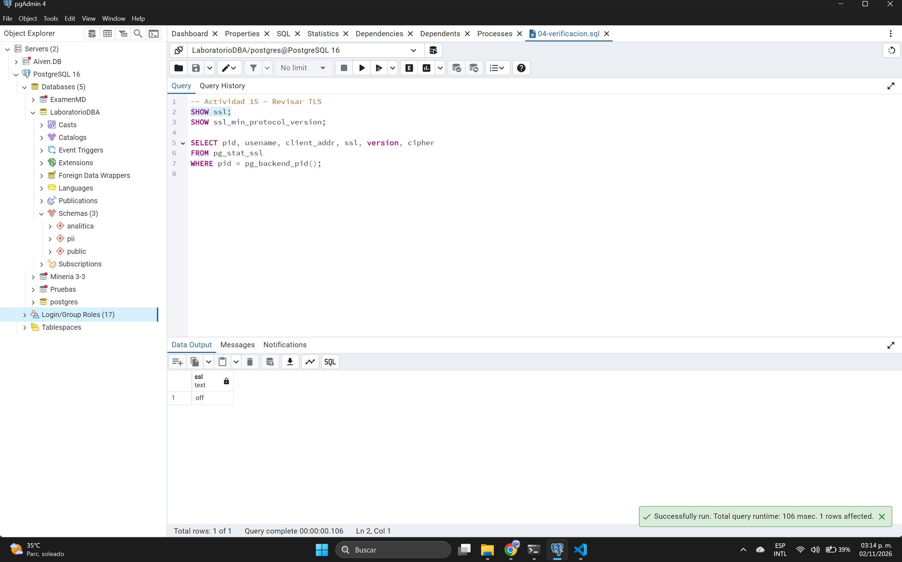
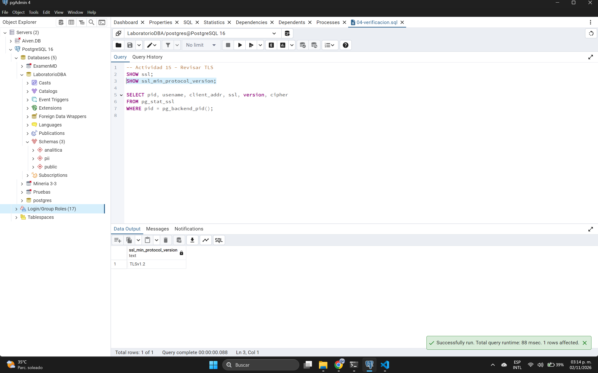
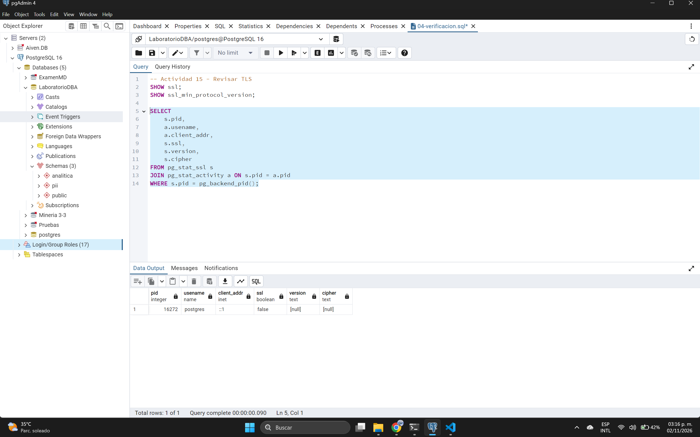

# Actividad 15 - Revisar TLS

**Resultados obtenidos de las evidencias:**

*   **Parámetro global SSL (`15.1.png`):** `off`
*   **Versión mínima de protocolo (`15.2.png`):** `TLSv1.2`
*   **Estado de la conexión actual (`15.3.jpg`):**
    *   `pid`: 16272
    *   `usename`: postgres
    *   `client_addr`: ::1 (localhost IPv6)
    *   `ssl`: false
    *   `version`: [null]
    *   `cipher`: [null]

### Determinaciones:

*   **¿La conexión actual utiliza TLS?** No. El servidor tiene el parámetro global `ssl` apagado (`off`) y la sesión activa confirma que la conexión no está cifrada (`ssl = false`).
*   **Versión:** No aplica (`[null]`), debido a que la conexión no está utilizando TLS. Sin embargo, sabemos que la configuración base requeriría al menos `TLSv1.2` en caso de habilitarlo.
*   **Cipher:** No aplica (`[null]`).

### Relación con LAB-02 y Análisis de Hardening:
Aunque en el LAB-02 se revisaron los conceptos de cifrado y TLS, en esta revisión de *hardening* (LAB-04) detectamos que **TLS no está habilitado** en el servidor de base de datos actual. 

Si este servidor estuviera en un entorno donde se aceptan conexiones a través de una red que no es de confianza (por ejemplo, desde otras subredes de la empresa o internet), esto representaría un riesgo grave, ya que credenciales (si no se usa SCRAM) y datos viajarían en texto plano. 

**Acción recomendada para el baseline:** Para aplicar un endurecimiento (hardening) efectivo, se debería cambiar `ssl = on` en `postgresql.conf`, configurar los certificados correspondientes y modificar el archivo `pg_hba.conf` para exigir el uso de `hostssl` en lugar de un simple `host` para conexiones remotas.

